# Talisman MIDI Project

  

As part of our commitment to open-source, this project aims to bring a community-driven approach to the process of creating software & profiles compatible with many MIDI devices.

It consists of libraries, apps, and device profiles that are all MIT-licensed, and available for anyone to use. It's also what powers the MIDI integration in all of our apps.

## Why?

This project was born out of frustration with the difficulties of creating
software that works reliably and consistently across a number of different
MIDI controllers.

MIDI itself is a fantastic protocol & ecosystem,
with great OS support, with thousands and thousands of supported devices,
and has completely transformed the music & creative industries,
however it is quite "low-level", and as a result:

- MIDI device manufacturers need to independently decide how they want to map
  the features of their device to MIDI Channels / Notes / CC messages etc...
- Software developers need to either:
  - Write code for each device they want to fully support
  - Create profile/preset systems, and allow users to create their own
    "profiles" for devices that map specific device messages to desired app functionality.
  - Only support "basic" functionality (e.g. no MIDI feedback etc, endless encoders, etc...)
    and allow users to configure which messages should perform which actions

### Doesn't this already exist?

To the best of our knowledge, not really...

There are many open-source projects with profile & preset definitions,
but they are all created with a specific use-case in mind,
rather than describing the full capabilities and nature of the devices themselves.
For example:

- [pencilresearch/midi](https://github.com/pencilresearch/midi) - A database of
  CSV mappings for most synthesizers on the market.
- [mixxx](https://github.com/mixxxdj/mixxx/tree/main/res/controllers) - has a
  repository of XML presets for mapping DJ controllers specifically to DJ
  functionality.

As such, this information isn't necessarily usable for every use-case,
and some devices in particular have idiosyncratic functionality that require
bespoke messages to be communicated over SysEx for desired behavior.

## What? - So what do Talisman profiles contain?

In-short, we want it to contain **EVERYTHING** there is to know about a MIDI device.

But practically-speaking, our aim is to map out anything that a software
application could use to intelligently and automatically understand how to
interpret messages coming from a specific device,
and know how to return feedback,
without developers or users having to explicitly add support for each
combination of device & application.

Profiles will contain, for example:

- Positional information of the different elements of a device
  (e.g. buttons, faders, LEDs, etc...)
- Information on feedback capabilities, and how to communicate that feedback, e.g:
  - Both Full RGB & Midi-Notes LED feedback, with color palettes
  - Encoder capabilities, and fill-mode (spot, fill, mirror, etc...)
  - LCD Scribble-Strips
  - Control of motorized faders, and how to handle capacitive touch sensors
- Mode-Switching requirements (e.g. many LaunchPad Controllers):
  Understanding if a device requires switching into a specific mode,
  and how to read the current mode & send messages to perform the mode switching.
- Whether button presses are send using Note ON/OFF, or only Note ON
- How to interpret endless encoder / DJ controller platter messages correctly
- How to handle numeric values that require more than `7` bits and are sent over
  multiple messages (e.g. Hercules Inpulse controllers)
- What a particular message _means_, and how it should be interpreted, e.g:
  - Navigational (up / right / enter)
  - Deck-Specific controls (platter, tempo, hot-cues, etc...)
  - Channel specific controls (mute, solo, fader, EQ, etc...)
  - XY Pads
- Support for popular custom firmware alternatives
- The list goes on...

## How?

This is a very ambitious project,
and so we intend to work on it gradually and in phases:

### Phase 1 - Device & API expansion (current)

During this phase,
the API is going to be in its most unstable state
and likely to change significantly as we add new devices and decide on how their
functionality should affect the overall API that we expose.

Profile implementations are going to primarily be in code,
rather than any sort of data schema,
so usage in other language ecosystems is not going to be possible.

We recommend that you develop software making use of this project during this
phase only if you:

- Use TypeScript (not JavaScript) for your code-base.
- Use a package manager with dependency locking.

The reason being is that when we introduce breaking changes,
we want those breakages to be obvious to you,
and quick to resolve. And we also want developers to have the option of easily
using older versions of our libraries if upgrading will be too much work.

### Phase 2 - Profile Schema Definition

Once enough consistent patterns emerge in device capabilities,
and what application logic is required to
translate these to and from MIDI messages,
we can start the process of defining a **schema** for what a profile looks like.

It is likely that only a subset of devices will move over to this schema
definition, and over time this number will increase.

During this phase,
applications written in other ecosystems will start to be able to use
device profiles,
specifically those that have moved over to being defined solely
in the new schema.

We will also be able to start exploring library implementations in other
languages.

### Phase 3 - Major version release and API stability

In this stage, we'll release v1.0 of the API & profile definitions,
and start to follow semantic versioning.

This does not mean that new features and capabilities will not be added to the
project, but it does mean that any future capabilities will need to be carefully
considered to avoid introducing breaking changes as much as is possible.

## Project focus & Device Support

You can see the current status of device support
(and whether they have been tested) from the
[Talisman page on the ArcaneWizards Website](https://arcanewizards.com/talisman),
or you can take a look at the code for
[`@talisman-midi/talisman-profiles`](./packages/profiles/).

We plan to increase the device support gradually over-time,
if you are interested in helping out,
please see out [contributing guidelines](./CONTRIBUTING.md).

We will not be accepting contributions for **ANY** MIDI device,
in particular the focus will be control surfaces rather than musical instruments.
See the contribution guidelines for more information.

## Official Project Apps

### [Talisman MIDI Lab](./apps/lab/)

  

This is for users who wish to:

- Test their MIDI hardware for compatibility with the project,
  and applications built using the project
- Build & test new profiles for the project (see [contributing docs](./CONTRIBUTING.md)).
- Use a number of our built-in utilities,
  such as MIDI message monitoring.

  
  &nbsp;&nbsp;
  
  &nbsp;&nbsp;
  

### [Talisman MIDI Arcade](./apps/arcade/)

  

An app with a number of arcade-like games that can be played on compatible
MIDI controllers.

  
  &nbsp;&nbsp;
  
  &nbsp;&nbsp;
  

## Libraries

Talisman is written in TypeScript, and published to NPM with Type-Definitions.
It can be used both in browser environments using Web MIDI, and locally using Node.js.

### [`@talisman-midi/talisman`](./packages/talisman/) - Base Library

API interface & type definitions, definitions of device capabilities, and utilities to help create & use profiles.

### [`@talisman-midi/talisman-profiles`](./packages/profiles/) - Device Profiles

Our own collection of device profiles, implementing the base API, and handling device eccentricities.

## Apps using Talisman

If you're working on an application that's making use of this project,
please feel free to open a pull request to add your app to this list.

- [Talisman MIDI Lab](./apps/lab/) - Including support for untested profiles
- [Talisman MIDI Arcade](./apps/arcade/)
- [Arcane Desktop](https://arcanewizards.com/arcane)

## [Usage / Documentation](./USAGE.md)

Detailed instructions on how to use the libraries in your own projects can be
found in the [How to use Talisman](./USAGE.md) docs.

## [Contributing](./CONTRIBUTING.md)

We encourage contributions to this repository,
in particular to add or improve support for different MIDI devices,
given that it will be impossible for the maintainers to build & test support for
all MIDI devices, as there are simply too many of them!

Please check out our [contributing guidelines](https://github.com/ArcaneWizards/talisman/blob/main/CONTRIBUTING.md)
before submitting any pull requests though,
in particular we require you to have an issue already assigned to you by a
maintainer before you submit any pull requests for most types of contributions.

In addition to code contributions,
please feel to [open an issue](https://github.com/ArcaneWizards/open-source/issues)
with any feedback that you have,
or any devices that you'd like to see us add support for.

## Community & Support

We have a [discussion board open](https://github.com/ArcaneWizards/talisman/discussions),
where you can share ideas, or showcase how you've been using the app.

If there's a particular device you are having issues with,
or would like to think about integrating into Arcane,
feel free to start a discussion [on the MIDI Devices board](https://github.com/ArcaneWizards/talisman/discussions/categories/midi-devices).

If you need any help using the app,
please feel free to ask [on the dedicated Help & Support board](https://github.com/ArcaneWizards/talisman/discussions/categories/help-support).

Beyond this,
we also have a [discord community](https://arcanewizards.com/discord),
where you are free to discuss anything and everything MIDI & Arcane.

## License

MIT License

Copyright (c) 2026 Arcane Wizards Ltd

Permission is hereby granted, free of charge, to any person obtaining a copy
of this software and associated documentation files (the "Software"), to deal
in the Software without restriction, including without limitation the rights
to use, copy, modify, merge, publish, distribute, sublicense, and/or sell
copies of the Software, and to permit persons to whom the Software is
furnished to do so, subject to the following conditions:

The above copyright notice and this permission notice shall be included in all
copies or substantial portions of the Software.

THE SOFTWARE IS PROVIDED "AS IS", WITHOUT WARRANTY OF ANY KIND, EXPRESS OR
IMPLIED, INCLUDING BUT NOT LIMITED TO THE WARRANTIES OF MERCHANTABILITY,
FITNESS FOR A PARTICULAR PURPOSE AND NONINFRINGEMENT. IN NO EVENT SHALL THE
AUTHORS OR COPYRIGHT HOLDERS BE LIABLE FOR ANY CLAIM, DAMAGES OR OTHER
LIABILITY, WHETHER IN AN ACTION OF CONTRACT, TORT OR OTHERWISE, ARISING FROM,
OUT OF OR IN CONNECTION WITH THE SOFTWARE OR THE USE OR OTHER DEALINGS IN THE
SOFTWARE.

  

